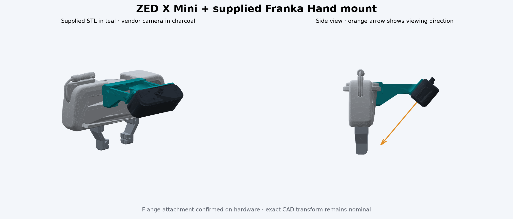

# Robotic manipulation lab

Minimal ROS 2 Jazzy / Gazebo Harmonic / MoveIt environment for an FR3 with a
parallel gripper and gripper-mounted **ZED X Mini** RGB-D camera. The robot starts idle.
Students implement perception, planning, execution and task coordination.

## Start

Use an Ubuntu Linux desktop with Docker Engine, Docker Compose and a working
GPU driver. The default configuration uses `/dev/dri` for Intel/AMD graphics.
For NVIDIA, install NVIDIA Container Toolkit and use `./scripts/run.sh --nvidia`.

```bash
./scripts/build.sh
./scripts/run.sh
```

The first container start builds the three small ROS packages. Then, inside
its terminal, launch **one** environment:

```bash
ros2 launch franka_sim_bringup lab.launch.py environment:=cubes
# OR
ros2 launch franka_sim_bringup lab.launch.py environment:=drawer
```

- **Cubes:** six 45 mm cubes, two each of red, green and blue. An example target
  structure is described in `ros2_ws/src/franka_sim_bringup/config/cubes_target.yaml`.
- **Drawer:** the corrected two-drawer cabinet (225 × 195 × 195 mm), with a
  7.5 mm roof and corner AprilTag, plus a cube, cuboid and cylinder on the table.

Launch options: `seed:=1`, `cube_count:=6` (1–12, cubes only), `rviz:=false`,
`gui:=false`. A seed repeats the initial layout; physics need not be bit-for-bit
identical. The six-block target requires the default six cubes.

To reset or switch scenes, stop the launch with Ctrl+C and launch again. Start
only one scene at a time. To open another terminal:

```bash
docker compose exec lab bash
```

The container keeps ROS 2 (domain 42, set `LAB_ROS_DOMAIN_ID` to change it)
and Gazebo traffic on this PC, so ROS tools outside the container do not see
the lab, and other ROS systems on the network do not interfere with it.

After the scene reports ready, check the infrastructure without moving the arm:

```bash
ros2 run franka_sim_bringup check_setup.py
```

Stop the lab container with `docker compose down`. To rebuild edited ROS
packages inside the running container:

```bash
cd /home/ros2_ws
colcon build --symlink-install --executor sequential
source install/setup.bash
```

## What is provided

- FR3 description, robot/camera TF, joint states, RGB/depth/stereo/IMU streams.
- Working arm and gripper trajectory controllers, MoveIt and RViz.
- A table collision object in MoveIt. Students add perceived object/drawer
  obstacles and manage attached objects themselves.
- Physical scenes and a read-only setup check. No detection, grasp selection,
  pick/place, drawer-opening or construction solution is included.

[Interfaces and coordinate conventions](docs/interfaces.md) describe the
available sensor and command interfaces. Gazebo object-pose and drawer-state
feeds are not exposed by this package. Use sensor observations in your solution.

## Optional student package

`ros2_ws/src/student_manipulation/` contains four modules: perception, planning,
execution and task coordination. Algorithm functions raise `NotImplementedError`;
`ros2 run student_manipulation task` only starts an idle node.

You may delete this entire directory, empty its modules or replace it with your
own package. Neither environment depends on it. When removing or renaming a
package, also remove that package's entries from the container's `build/` and
`install/` directories before rebuilding, so stale executables do not remain.

## Workspace

- `franka_description`: vendored FR3 and hand geometry/kinematics only.
- `franka_sim_bringup`: environments, sensors, controllers and launch files.
- `student_manipulation`: removable Python starter package.
- `franka_real_bringup`: the physical FR3 and Franka Hand with the simulation's
  interfaces.

## Real robot

The `real_robot` branch adds a second Docker image with libfranka and the
franka_ros2 driver (`./scripts/build.sh --real`, `./scripts/run.sh --real`) and
`ros2 launch franka_real_bringup real.launch.py`, which leaves the arm
uncommanded until `arm:=active` or a supervisor activates it. Only run it while
someone watches the robot. See [Real FR3](docs/real_robot.md) for setup, the
staged bringup and the differences from simulation, and the
[TA checklist](docs/ta_checklist.md) for sessions. On hardware the ZED X Mini
streams from a Jetson; `./scripts/run.sh --real --zed` also starts the
receiver, which publishes the same `/zed_x_mini/` topics as the simulation.

### Real camera

The Jetson must stream the camera before the receiver gets any images. From
the lab PC, log in to the Jetson (password `jetson2025`):

```bash
ssh jetson@192.168.55.1
```

On the Jetson, start the sender and keep this terminal open while you work:

```bash
python "/usr/local/zed/samples/camera streaming/multi_sender/python/streaming_senders.py"
```

Then start the containers on the lab PC with `./scripts/run.sh --real --nvidia --zed`.

If no image arrives and `docker logs franka_lab_zed` repeats "CAMERA NOT
INITIALIZED", the Jetson still holds the previous receiver's session, for
example after the containers were restarted. Restart the receiver after a
short pause:

```bash
docker stop franka_lab_zed && sleep 15 && docker start franka_lab_zed
```

## ZED X Mini camera and supplied mount

Both scenes (simultion and Real) use Stereolabs’ ZED X Mini
mesh, a 50 mm stereo baseline and a 150 g camera mass. The wide-angle 2.2 mm
lens is assumed. Images use nominal rectified HD1200 calibration: 1920 × 1200,
fx = fy = 737 px (about 105° × 78°), at the lab’s 15 Hz rate. Depth clips at
0.1–8 m. Gazebo renders depth directly; it does not emulate ZED SDK stereo
matching. Topics are under `/zed_x_mini/`; see [interfaces](docs/interfaces.md).

The supplied [zedminixmount.stl](ros2_ws/src/franka_sim_bringup/meshes/zedminixmount.stl)
is included and used for both
visuals and collision checking. It replaces the previous custom bracket.

