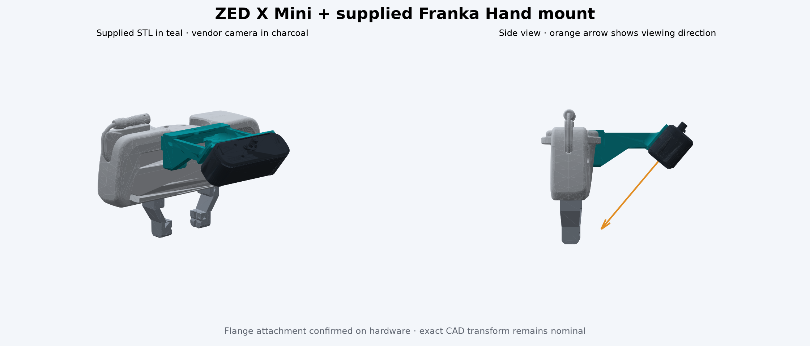

# ZED X Mini assembly

The simulation uses the supplied `zedminixmount.stl` unchanged. Its dimensions
are 85.225 × 90 × 43.747 mm; it is one closed solid with 106,392 triangles.
The camera is the manufacturer's ZED X Mini mesh, with a 50 mm stereo baseline.
The wide-angle 2.2 mm lens is assumed.

## Confirmed attachment and nominal CAD placement

The project owner confirmed on 2026-10-18 that this mount is already fitted
around the physical hand's base flange. The attachment location is confirmed;
the numerical simulation transform below is still inferred from the meshes.

The rear channel is 8.5 mm high. In the chosen placement it surrounds the
hand's base flange, with its central bore aligned at hand x = -25 mm, y = 0.
The two rear tabs sit alongside the hand body. This is a direct attachment to
the stationary hand, not a moving finger link.

The tilted plate has a 3 mm seating thickness, a central 10 mm opening and
two 4 mm bores spaced 36 mm apart. These align with the camera's bottom
tripod and M3 holes. Camera +x points toward the fingertips at a 50° pitch.
The GMSL connector faces away from the fingers. Cable geometry is not modeled.

**CAD/placement discrepancy:** the lower flange clip overlaps the vendored FR3 wrist
geometry. MoveIt reports approximately 1.2 mm contact depth in the ready pose.
The mount/hand, mount/wrist and mount/camera pairs are treated as rigid adjacent
attachments in the SRDF; collisions with fingers and other robot links remain
enabled. The reported physical installation confirms that the mount can be
fitted at this attachment point. Resolving the simulated overlap requires
comparing the modeled surfaces and exact transform with that installation;
the supplied geometry has not been trimmed to hide the discrepancy.

| Transform | Translation (metres) | RPY (radians) |
|---|---|---|
| Hand → original STL axes | -0.025, 0.040, 0.017 | 0, 0, π |
| Original STL axes → camera bottom screw | 0.0656689, 0.040, -0.0141432 | 0, -50π/180, π |
| Hand → camera bottom screw | -0.0906689, 0, 0.0028568 | 0, -50π/180, 0 |

The camera is seated on the upper plate face; the screw bores agree within
0.02 mm in the supplied and vendor meshes. Do not infer screw length or
thread engagement from an STL. Use the camera's current mechanical drawing
and the measured printed seating thickness. Hardware requires hand-eye
calibration and per-device CameraInfo.

## Reproduce generated constants

From a Python environment with `numpy` and `trimesh` installed:

```bash
python cad/zed_x_mini/prepare_mount.py
```

The script checks the input hash and regenerates
`ros2_ws/src/franka_sim_bringup/urdf/zed_x_mini_mount.generated.xacro`.
It does not change the STL. Its 67.53 g mount mass assumes solid PLA at
1240 kg/m³; actual printed mass depends on material and infill. Camera mass
is 150 g with approximate bounding-box inertia. These are simulation estimates.



## Simulation validation (2026-10-18)

Both scenes were built and checked in the ROS 2 Jazzy / Gazebo Harmonic lab
container. Each passed the 26 read-only infrastructure checks, calibration
checks, 11 gripper openings from 0 to 40 mm per finger, and two MoveIt arm
motions. These collision checks retain the three fixed attachment exclusions
explained above. The nominal transform has not been measured on hardware.

**Hand orientation (2026-10-27).** `fr3_hand`, and with it the mount and
camera, is now at −45° about the flange z axis, as on the physical FR3; before,
it was aligned with the flange. The 1.2 mm contact figure above predates this
change. Gazebo now keeps `camera_link` as a separate link: it derives the right
camera's stereo baseline from the sensors' y offset in their parent link, and in
the merged `fr3_link7` the rotated hand shortened it to 35 mm. Afterwards both
scenes again passed all 26 infrastructure checks (right camera
P[3] = −0.05 × fx). MoveIt found no collision at the start pose or over a
joint 7 sweep from −2.9 to 2.9 rad, and a simulated wrist motion settled back
at its start.

Native HD1200 resolution is used because the small drawer tags were not all
reliably decoded in a single overview at SVGA. At HD1200, all five AprilTags
(52, 56, 57, 61, 62) were detected in one overview. Back-projecting the green
cuboid's depth through CameraInfo and TF gave a median surface error of
2.8 mm and a 95th-percentile error of 9.0 mm, with the existing synthetic noise.
The camera naturally sees part of the hand; viewing pose affects occlusion.

Instructor validation scripts and captures are in the ignored local
`output/zed-x-mini/` directory. No perception or manipulation solution was
added to the student package.
